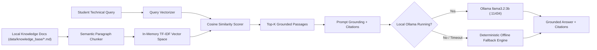
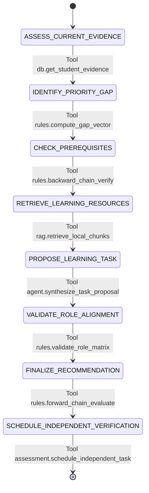

# MERIDIAN — AI, RAG & Agentic Workflow Guide

## 1. Zero-Cost Local RAG Pipeline Architecture

MERIDIAN is designed to eliminate reliance on external paid API providers (such as OpenAI, Anthropic, or cloud vector databases) while maintaining high retrieval precision.

### 1.1 In-Memory Semantic Retrieval Engine
- **TF-IDF + Cosine Similarity:**
  Each chunk is represented as a normalized frequency vector weighted by Inverse Document Frequency:
  $$\text{IDF}(t) = \ln\left(\frac{N + 1}{\text{DF}(t) + 1}\right) + 1$$
  Cosine similarity ensures that the most relevant paragraphs are returned regardless of paragraph length.
- **Strict Grounding:**
  Answers must cite the originating file and chunk section (e.g., `[python_oop_guide.md - Chunk 1]`). If similarity falls below the threshold (0.08), the system honestly admits lack of reference material.

### 1.2 Graduated Hint Policy
When assisting students, MERIDIAN avoids giving away complete solutions:
1. **Level 1 (Conceptual Hint):** Explains the foundational concept without writing code.
2. **Level 2 (Specific Hint):** Points to the relevant syntax, function, or loop construct.
3. **Level 3 (Guided Reasoning):** Provides step-by-step pseudo-code or reflective questions.
4. **Level 4 (Worked Example):** Provides an analogous snippet on a different problem domain.

---

## 2. Bounded Agentic Workflow Specification

The `BoundedLearningAgent` (`backend/app/agent/workflow.py`) executes an observable, 8-state bounded workflow. It prevents non-terminating loops and enforces hard safety constraints.

### 2.1 Hard Constraints
- **Max Steps:** Capped at 8 steps.
- **Allowlisted Tools Only:** Restricted to internal deterministic modules (`db.*`, `rules.*`, `rag.*`, `assessment.*`).
- **No Arbitrary Shell or Code Execution:** The agent cannot execute commands on the host machine.
- **No Autonomous Certification:** The agent cannot mark a skill as `demonstrated_independently`; only the student's unassisted submission can earn that state.
