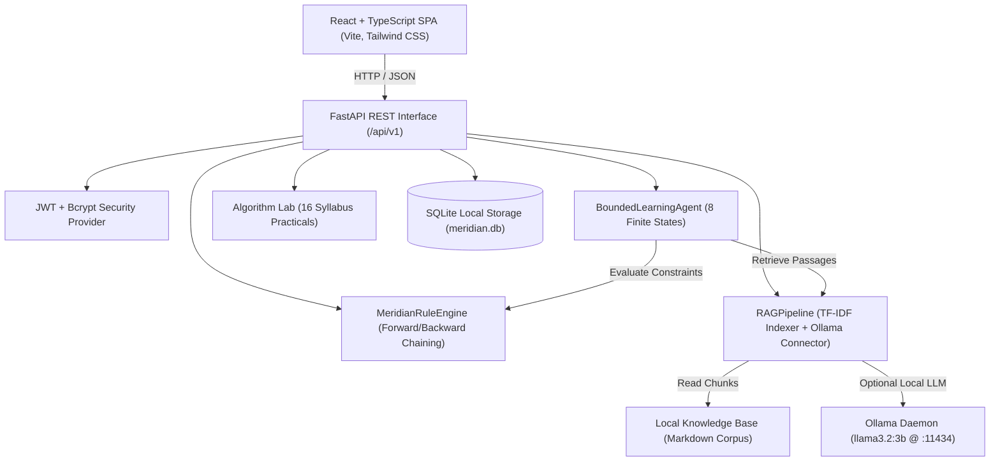
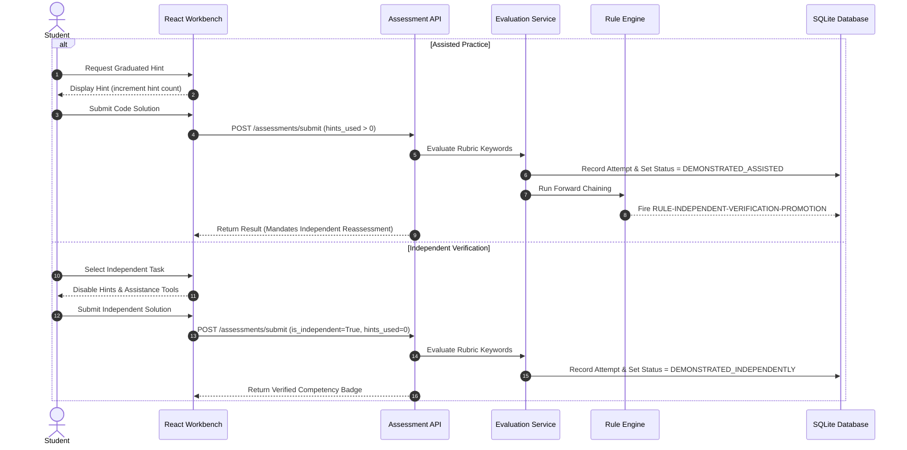

# MERIDIAN System Architecture Specification

## 1. Architectural Philosophy
MERIDIAN is engineered as an offline-first, competition-grade educational intelligence platform. It enforces a foundational distinction:
**AI scaffolding provides guidance during learning, but only unassisted independent assessments verify demonstrated mastery.**

## 2. Layer-by-Layer Decomposition

### 2.1 Frontend Presentation Layer (`frontend/`)
- **Technology Stack:** React 19, TypeScript, Vite, Tailwind CSS v4 (`@tailwindcss/postcss`), Lucide React icons.
- **State Management:** Reactive hooks with decoupled API abstraction layer (`src/api.ts`).
- **Design Philosophy:** Restrained slate/charcoal palette (`#0b1120`, `#1e293b`) with accessible teal accents (`#0d9488`).
- **Core Views:**
  1. **Dashboard:** Target role switcher, assessed competency matrix, explainable recommendations.
  2. **Assessment Workbench:** Split between Assisted Practice (graduated hints) and Independent Verification (strictly unassisted).
  3. **AI Assistant & RAG:** Grounded chat with graduated hint policies (Levels 1 to 4) and citation display.
  4. **Bounded Agent View:** Live visual step trace for the 8-state learning agent.
  5. **Rule Explorer:** Interactive forward-chaining rule inspector and conflict resolution audit log.
  6. **Algorithm Lab:** Interactive execution runner for all 16 syllabus practicals with customizable parameters.

### 2.2 Backend Application Layer (`backend/app/`)
- **Framework:** FastAPI with strict Pydantic schemas for request/response serialization and validation.
- **Endpoints (`app/api/endpoints.py`):**
  - `/auth/*`: Registration, login, current profile, target role update.
  - `/roles/competencies`: Role curriculum matrix.
  - `/skills/evidence`: Persistent student skill states.
  - `/assessments/*`: Task catalog and rubric submission evaluator.
  - `/recommendations`: Active rule-driven remedial tasks.
  - `/rules/*`: Forward-chaining evaluation and backward-chaining goal proof trees.
  - `/chat/query`: RAG retrieval, prompt grounding, Ollama query, and deterministic fallback.
  - `/agent/run`: Bounded agent state machine execution.
  - `/algorithms/practical/{id}`: Syllabus practical runners.
  - `/health`: System diagnostic health check.

### 2.3 Knowledge Retrieval & RAG Layer (`backend/app/rag/`)
- **Indexing:** In-memory TF-IDF vectorization with cosine similarity scoring across chunked markdown files in `data/knowledge_base/`.
- **Zero-Cost Policy:** Completely local; zero external network calls or cloud API subscriptions.
- **Inference Strategy:**
  1. Check local Ollama daemon (`http://localhost:11434`) for target model `llama3.2:3b`.
  2. If reachable within timeout, synthesize grounded response incorporating cited passages.
  3. If Ollama is offline or busy, transparently switch to the **Deterministic Knowledge Fallback Engine**, explicitly labeling the response and quoting verified textbook chunks.

### 2.4 Expert Rule Engine (`backend/app/rules_engine/`)
- **Forward Chaining:** Evaluates candidate rules against student facts (target role, skill mastery levels, attempt counts).
- **Conflict Resolution:** Deterministic priority ordering (Rule priorities 10 to 100).
- **Backward Chaining:** Recursively verifies whether all prerequisite competencies are satisfied before declaring a goal skill certifiable.
- **Full Provenance:** Every recommendation retains the originating rule identifier (e.g., `RULE-INDEPENDENT-VERIFICATION-PROMOTION`).

### 2.5 Data Persistence Layer (`backend/app/models/`, `backend/app/core/database.py`)
- **Database Engine:** SQLite (`meridian.db`) via SQLAlchemy ORM.
- **Domain Models:**
  - `User`: Credentials, profile, role target.
  - `RoleCompetency`: Curriculum graphs and prerequisite links.
  - `AssessmentTask`: Prompts, templates, rubrics, and independent flags.
  - `AssessmentAttempt`: Raw submissions, rubric keyword matches, time, hints used.
  - `SkillEvidence`: Persistent skill state machine (`unassessed`, `needs_development`, `developing`, `demonstrated_assisted`, `demonstrated_independently`).
  - `Recommendation`: Rule-generated remediation directives.
  - `AgentRunLog`: Serialized state transition history.

---

## 3. Data Flow Diagrams

### Assisted vs. Independent Assessment Lifecycle

